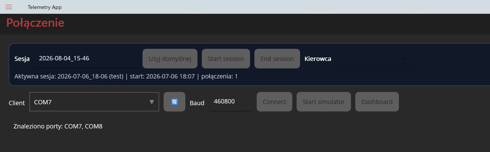
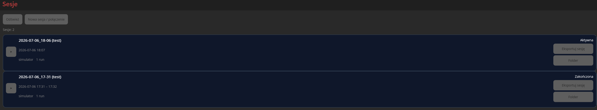
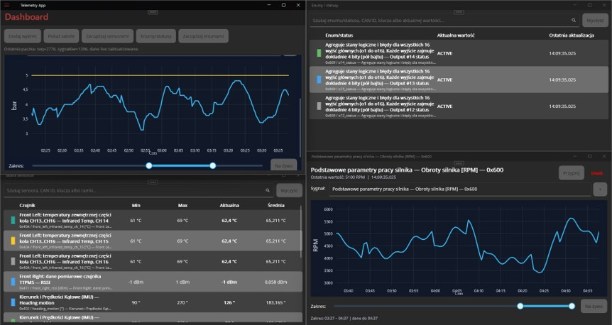

# TelemetryApp

Aplikacja do obsługi, dekodowania i analizy danych telemetrycznych, zbudowana w technologii .NET MAUI. Projekt wspiera pracę z sesjami pomiarowymi, połączeniami z urządzeniem, wizualizacją danych oraz eksportem wyników do formatu CSV.

## Opis projektu

`TelemetryApp` jest narzędziem do monitorowania i analizy danych z układu pomiarowego / urządzenia CAN. Aplikacja umożliwia:

- zarządzanie sesjami pomiarowymi,
- podłączenie do źródła danych,
- odczyt i dekodowanie ramek telemetrycznych,
- podgląd danych w formie dashboardu,
- analizę danych z wykorzystaniem silnika Python,
- eksport danych do plików CSV,
- konfigurację wyświetlania sygnałów i ustawień eksportu.

## Główne funkcje

- Połączenie z urządzeniem / modułem pomiarowym
- Rejestracja i przegląd sesji
- Dashboard z podglądem sygnałów i danych w czasie rzeczywistym
- Zarządzanie definicjami CAN i sygnałami
- Eksport sesji do CSV
- Wsparcie dla logiki analitycznej w Pythonie
- Ustawienia użytkownika i widoku sygnałów

## Technologie

- .NET MAUI
- C#
- SQLite
- LiveCharts
- SkiaSharp
- Python.Included
- PythonEngine (skrypty analityczne)

## Struktura projektu

```text
TelemetryApp/
├── Backend/              # logika aplikacji, sesje, protokół, eksport, pipeline
├── Frontend/             # widoki, view modele, kontrolki UI
├── PythonEngine/         # skrypty Pythona używane do analizy danych
├── Resources/            # ikony, fonty, obrazy, splash screen
├── Platforms/            # konfiguracja platform targetowych
└── TelemetryApp.csproj   # projekt MAUI
```

## Wymagania

Przed uruchomieniem projektu upewnij się, że masz zainstalowane:

- .NET SDK 10
- Visual Studio 2022 z obciążeniem .NET desktop / MAUI
- Windows 10+ (dla targetu Windows) lub macOS (dla Mac Catalyst)
- opcjonalnie środowisko Python, jeśli chcesz uruchamiać skrypty analityczne niezależnie od pakietu `Python.Included`

## Uruchomienie

1. Otwórz solution:

   ```bash
   dotnet restore TelemetryApp.sln
   ```

2. Zbuduj projekt:

   ```bash
   dotnet build TelemetryApp/TelemetryApp.csproj
   ```

3. Uruchom aplikację z poziomu Visual Studio lub przez:

   ```bash
   dotnet run --project TelemetryApp/TelemetryApp.csproj
   ```

> Uwaga: w środowisku Windows projekt jest przeznaczony głównie dla targetu `net10.0-windows10.0.19041.0`.

## Przykładowe sekcje aplikacji

Aplikacja posiada główne zakładki / strony takie jak:

- Połączenia
- Sesje
- Dashboard
- Ustawienia
- Python Test

## Zrzuty ekranu

Poniżej zostawiono miejsca na najważniejsze widoki aplikacji:

### Menu połączeń



### Istniejące sesje



### Widok danych



## Notatki deweloperskie

- Projekt wykorzystuje `PythonEngine` do obliczeń wspierających analizę danych.
- Dane sesji są przechowywane lokalnie za pomocą SQLite.
- Skrypty Python są kopiowane do katalogu wyjściowego projektu przez konfigurację `csproj`.
